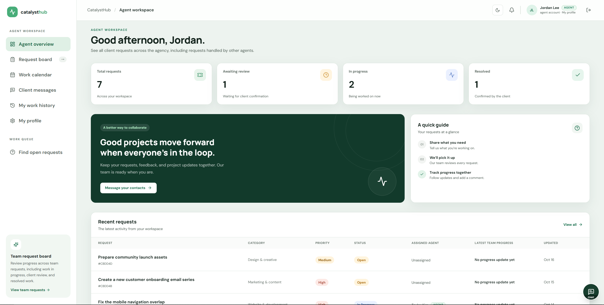

<div align="center">
  
  <h1>CatalystHub</h1>
  <p>A shared workspace for client requests, agency work, and clear project updates.</p>
  <p>
    <a href="https://catalyst-hub-beryl.vercel.app">Open the live website</a>
  </p>
  <p>
    
    
    
    
  </p>
</div>

<p align="center">
  
</p>

## What you can do

| Clients | Agents | Admins |
|---|---|---|
| Submit and track requests | Browse the team queue and respond to open work | Approve agent accounts and assign requests |
| Compare agent responses and choose who works | Share progress and send work for client review | Search and manage accounts and requests |
| Discuss work, share files, and review delivery | Coordinate with approved helpers | Review agency activity |

Everyone gets private messages, notifications, activity history, calendars, and editable profiles. New accounts verify their email with a six-digit code before registration completes. Agent accounts need admin approval before sign-in.

## Tech stack

- **Web:** React, TypeScript, Vite, Tailwind CSS
- **API:** Node.js, Express, TypeScript, Mongoose
- **Database:** MongoDB
- **Email verification:** Gmail SMTP with a Google App Password

## Run locally

### You’ll need

- Node.js 20 or newer
- MongoDB running locally or an Atlas connection string

### Start the app

1. Copy `server/.env.example` to `server/.env` and fill in the values below.
2. From the repository root, install packages and start the web app and APIs:

   ```bash
   npm install
   npm run dev
   ```

3. Open the Vite address printed in the terminal (usually `http://localhost:5173`).

The main API uses port `5000`; the local guest demo API uses port `5001`.

### Environment variables

| Variable | Purpose |
|---|---|
| `MONGODB_URI` | Main application database |
| `JWT_SECRET` | Signs login tokens; use a long random value |
| `CLIENT_ORIGIN` | Website origin allowed by the API, such as `http://localhost:5173` |
| `GMAIL_USER` | Gmail account used to send verification codes |
| `GMAIL_APP_PASSWORD` | Google App Password (not your regular Gmail password) |
| `EMAIL_OTP_SECRET` | Separate random secret for email verification codes |
| `MONGODB_GUEST_URI` | Separate database for guest demo data; its name must include `guest` |

Keep database credentials and signing secrets private. Never commit `.env` files.

## Deploy on Vercel

Create **two Vercel projects from this same GitHub repository**:

| Project | Root directory | Preset | Variables |
|---|---|---|---|
| Website | `client` | Vite | `VITE_API_URL` (**Config**) = `https://<api-domain>/api` |
| API | `server` | Express | Use the API variables listed below |

| API variable | Vercel type | Purpose |
|---|---|---|
| `MONGODB_URI` | Secret | Main application database |
| `JWT_SECRET` | Secret | Login token signing key |
| `EMAIL_OTP_SECRET` | Secret | Verification-code signing key |
| `GMAIL_APP_PASSWORD` | Secret | Gmail SMTP credential |
| `CLIENT_ORIGIN` | Config | Website origin, such as `https://your-site.vercel.app` |
| `GMAIL_USER` | Config | Gmail sender account |

Set the API project’s `CLIENT_ORIGIN` to the website’s exact origin. Add variables to **Production** and redeploy the project after changing them. The API domain is shown on the API project’s Vercel deployment page.

## Local guest demo

The guest workspace uses its own API and database so demo data stays separate from real accounts. Guest content is shared with other visitors and resets daily. **Do not enter real client information or sensitive data in the demo.**

For local development, point `MONGODB_GUEST_URI` to a separate database whose name includes `guest`. Never point it to the main database.

## Checks and preview data

```bash
npm test
npm run build
```

The integration check and preview-data scripts are restricted to the local `mympp_test` database:

```bash
npm run test:integration --workspace server
npm run seed:preview --workspace server
npm run reset:preview --workspace server
```

Preview seeding prints local demo credentials. Keep `server/.env.test` pointed at the local test database; **never use production data for tests or previews**.

## License

[MIT](LICENSE)
