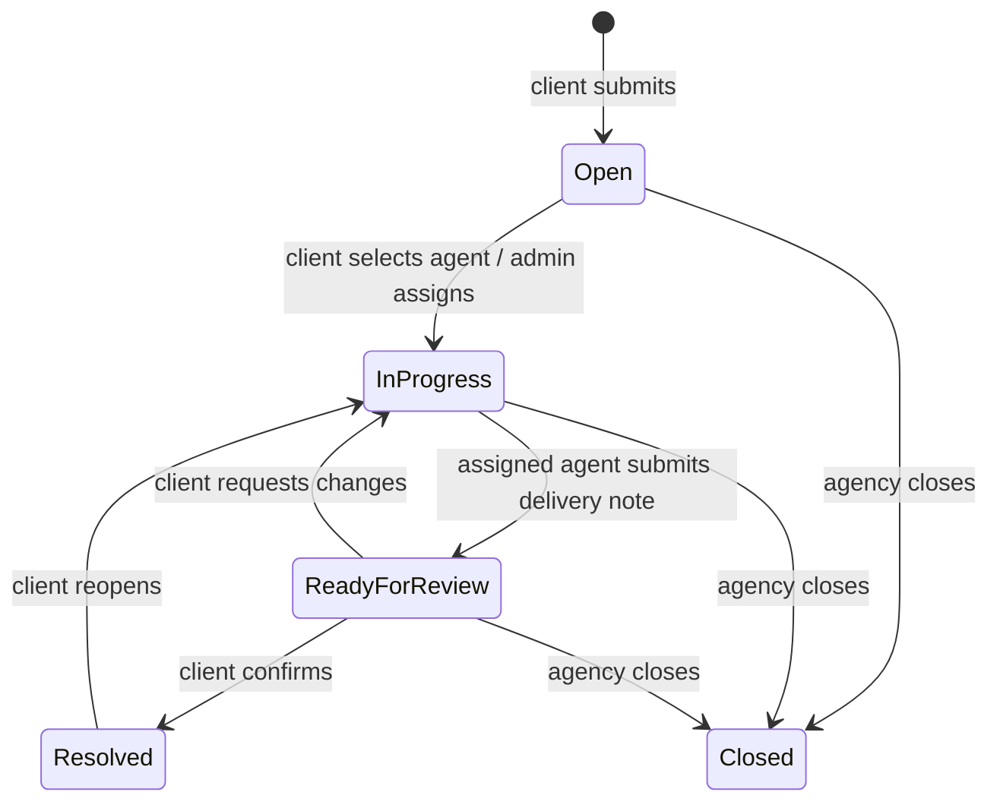
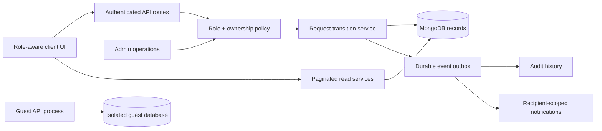

# CatalystHub System Audit

**Review date:** 2026-10-18  
**Scope:** Static review of the repository guide, README, React client, Express routes and middleware, Mongoose models, shared services, and available tests. This is a source review; it did not use a live MongoDB instance, exercise the UI in a browser, inspect a production deployment, or run tests.

## 1. Executive summary

CatalystHub has a coherent core service model: clients submit requests, approved agents respond, clients choose an agent, the selected agent delivers work for review, and the client confirms completion. The server enforces most important ownership and assignment boundaries, and the guest workspace is isolated behind a separate API/database path. Several recent improvements are reflected in both source and `project.md`.

The most important issues are at the seams between modules. The activity API returns actor email addresses to non-admin users; private-message file attachments are accepted by the route but rejected by the persistence schema; oversized messages pass route validation but exceed model limits; and the admin status endpoint can put work into client review without a delivery handoff. Account suspension/deletion also treats requests in review differently from other active work. These are confirmed from source and should be addressed before further feature expansion.

The main operational risks already recorded in `project.md` remain relevant: activity/notification writes are best effort after business writes, multi-record deletion is not transactional, ticket and conversation lists are unbounded, conversation previews use an N+1 query pattern, lifecycle transitions can race, and login/registration have no application-level throttling. No configured integration database or end-to-end harness was found, so database concurrency and real-browser behavior remain unverified.

**Recommended direction:** define one explicit request state machine and event policy, align request validation with persistence, minimize response data by role, make disable/delete operations resumable and state-aware, and add API integration coverage before broad UI refactoring.

## 2. Workflows and modules reviewed

| Area | Current flow and connected modules |
|---|---|
| Sign-in and identity | React auth context restores a bearer-token session; registration accepts client or agent roles; agents await admin approval; middleware loads and checks the account for each authenticated API request. |
| Client request | Client creates a request, searches/filters the request list, edits while open, follows status and conversation, compares agent responses, chooses one agent, reviews the delivery, then confirms resolution or requests changes. |
| Agent work | Approved agent sees the agency-wide request board, replies to open unassigned requests, can update their response within the configured limit, waits for client selection, progresses assigned work, sends a delivery note/proof for review, and can cancel eligible work. |
| Admin operations | Admin reviews activity and agent approvals, manages users, assigns requests, adjusts operational fields, bans/unbans accounts, and deletes client/agent accounts. |
| Request conversation | Ticket detail combines legacy embedded comments and separately stored thread messages; messages support attachments, reactions, edits, and tombstones. Access is limited to the client, assigned agent, and admins. |
| Private messaging | Contacts are role/assignment-scoped; a two-person conversation is found or created; messages and notifications are stored separately. The inbox loads conversation rows and then retrieves each latest message. |
| Notifications and activity | `trackEvent` writes audit events and recipient notifications after business actions. Recipient-scoped notification routes and participant-scoped non-admin activity queries are present. |
| Profiles | Users edit profile/password/email/appearance through separate actions; public member cards expose role-specific statistics; agents have searchable, date-filtered completion history. |
| Calendar and dashboard | Dashboard summaries, request tables, and calendar use the ticket API; calendar places requests on due date or falls back to creation date. |
| Guest demo | A second API process shares route code but uses a guest JWT secret and separate database; demo data is reset daily and clearly presented as shared/temporary. |
| Visual system | React/Tailwind UI uses global theme tokens plus compatibility remaps for existing literal color utilities; most page and interaction code remains concentrated in `client/src/App.tsx`. |

### Intended request lifecycle

`Closed` is intentionally distinct from client-confirmed `Resolved`. The state transitions are currently enforced across multiple route handlers rather than one centralized transition service, which makes consistency and concurrency harder to maintain.

## 3. Contradictions, inconsistencies, and logic conflicts

### High — Activity response exposes actor email to ordinary users

- **Evidence:** `GET /api/admin/activity` is registered before the admin-only middleware in `server/src/routes/admin.ts`. Non-admin queries are filtered to events where they are participants, but the actor is populated with `name email role`.
- **Why it matters:** an agent or client can receive another participant’s sign-in email in the JSON response even though the UI only needs the actor name. This exceeds the minimum data needed for the activity view.
- **Recommendation:** populate only public identity fields for non-admin callers, or use separate serializers. Return email only to admins where there is a clear operational need.
- **Complexity/dependencies:** Low; route serializer and API contract only.
- **Trade-off:** admins retain broader visibility; non-admin activity search continues to work by name/summary.
- **Acceptance:** client and agent activity responses never include another user’s email; admin response behavior is explicitly documented and tested.

### High — Account disable/delete can strand requests at client review

- **Evidence:** `releaseActiveWorkForUser` in `server/src/services/workAssignment.ts` only selects `Open` and `In Progress`. Banning an agent calls that helper. Agent deletion also calls it, then broadly nulls any remaining `assignedTo` reference without moving review work back to an actionable state or preserving the handoff message.
- **Why it matters:** a request in `Ready for review` can stay in review assigned to a banned agent, or become unassigned during deletion while retaining review status. If the client requests changes, the request returns to work for an agent who cannot sign in; deletion also removes the agent’s authored messages, including delivery proof.
- **Recommendation:** define state-aware disable/delete behavior for all nonterminal requests. For review-stage work, preserve the delivery record and let the client finish review or explicitly return the request to the queue with a visible reason and a new owner. Make deletion resumable and idempotent.
- **Complexity/dependencies:** Medium to High; lifecycle policy, audit/history retention, and deletion semantics.
- **Trade-off:** requires a clear decision about retaining work records after an account is removed.
- **Acceptance:** no active/review request is left assigned to an unusable account; client-facing status and conversation history accurately show what happened.

### High — Admin can bypass the required delivery handoff

- **Evidence:** the generic `PATCH /tickets/:id` route rejects agents setting `Ready for review`, but accepts the same status from admins when the prior status is `In Progress`. It sets `workCompletedBy` to `null` for an admin and does not require a delivery note. The client review UI then has no named worker/proof to show.
- **Why it matters:** this creates a path into client review that bypasses the documented “assigned agent submits note/proof” rule and can produce a resolved request with no credited agent.
- **Recommendation:** separate administrative override from the agent handoff. Either disallow admin transition to `Ready for review`, or require a reason and a named worker/handoff record with a distinct client-facing presentation.
- **Complexity/dependencies:** Medium; status API, audit event shape, and client review UI.
- **Trade-off:** admins lose a shortcut unless the explicit override path is retained.
- **Acceptance:** every request entering client review has a durable handoff record, or an explicit audited admin override that the client can distinguish.

### Medium — Private-message file attachments cannot be persisted

- **Evidence:** `server/src/routes/messages.ts` uses the shared attachment validator, which accepts `kind: 'file'` and document MIME types. `server/src/models/DirectMessage.ts` only permits `image` and `audio` in its Mongoose attachment enum; request messages in `ThreadMessage.ts` do permit `file`.
- **Why it matters:** the UI can offer document uploads in private conversations, but valid files fail during model validation and return an unexpected server error. README and project guide claim document support for private messages.
- **Recommendation:** align the direct-message attachment schema with the shared attachment type and preserve server-side MIME, extension, size, and payload checks.
- **Complexity/dependencies:** Low; schema/API contract and a route-level integration test.
- **Trade-off:** stored message records become compatible with all currently supported attachment kinds.
- **Acceptance:** supported PDF/text/CSV/Office/ZIP attachments send, reload, and download in private conversations; unsupported types remain rejected with a 4xx response.

### Medium — Message limits disagree between route validation and storage

- **Evidence:** ticket and direct-message routes accept text up to 20,000 characters (plus a word limit), while both `ThreadMessage.ts` and `DirectMessage.ts` set `maxlength: 2000`. The standard composer permits up to 20,000 characters.
- **Why it matters:** messages above the model limit pass validation but fail at persistence, turning a user-correctable length issue into a generic server error. The advertised/API limit is misleading.
- **Recommendation:** choose one supported character limit, use it in client composer, route schema, and Mongoose model, and return a clear validation error before saving.
- **Complexity/dependencies:** Low; client and API contract.
- **Trade-off:** either a smaller visible limit or larger stored messages and a size review.
- **Acceptance:** inputs at the documented maximum save successfully; inputs over it receive a clear 400 response without a 500.

### Medium — Admin activity authorization and privacy need a deliberate contract

- **Evidence:** `/admin/activity` is authenticated for all roles and scoped by `participants` for non-admin users, while route naming and project guide call it an admin activity endpoint. The current client uses it for personal activity as well as admin logs.
- **Why it matters:** the behavior is currently split between role checks and filtering inside one route; changes to populate, search, or filter logic can unintentionally broaden private activity access.
- **Recommendation:** keep a shared implementation if desired, but make the distinction explicit with separate route/service policy and role-aware output schemas. Pair with the email minimization fix above.
- **Complexity/dependencies:** Low to Medium; route contract and client API calls.
- **Acceptance:** tests demonstrate what a client, agent, and admin may list and which fields each may receive.

### Medium — Calendar can make submission dates look like deadlines

- **Evidence:** when `dueDate` is absent, the calendar positions a request by `createdAt` (documented in `project.md` and used by the client grouping code).
- **Why it matters:** a client or agent scanning a calendar can mistake a submission date for a promised due date, especially when the page visually treats both as the same event.
- **Recommendation:** label fallback events “Submitted” and due-date events “Due,” or give them different visual markers and filters. Do not imply an SLA where no due date exists.
- **Complexity/dependencies:** Low; calendar presentation and accessible legend.
- **Acceptance:** event type/date meaning is clear without opening the request; filtering by due date excludes requests with no due date.

### Low — Workspace navigation was shared across roles

- **Evidence:** the common shell previously showed a client “Create request” callout and generic labels to agents. The latest workspace update made labels and links role-specific in `App.tsx`, but role-aware route behavior still lives in the large shared shell/page file.
- **Why it matters:** client actions can look available to agents even when the API correctly denies them; generic names make client and agency workflows harder to tell apart.
- **Recommendation:** retain the role-specific labels and actions; extract a typed navigation configuration and add role-based route/visibility checks so the menu stays aligned with API permissions.
- **Complexity/dependencies:** Low; UI-only, with no API changes.
- **Acceptance:** client, agent, and admin each see only their intended actions and clearly named work areas at desktop and mobile widths.

## 4. Workflow inefficiencies and proposed processes

| Workflow | Current friction | Proposed flow |
|---|---|---|
| Client request assignment | Several agents can respond; client selects; admin can assign directly. The UI and activity history must reconcile two distinct assignment paths. | Keep both paths, but record a common `assignmentSource` (`client_choice` or `admin_assignment`) and show who selected/assigned the agent. Require an active approved agent in both paths. |
| Work review | Agent submit-review writes a message, changes ticket state, then writes multiple audit/notification records separately. Admin generic status patch has a parallel shortcut. | One transition service validates prior state, writes the handoff/state, then emits durable lifecycle events. Only an explicit override can bypass agent submission. |
| Account disable/deletion | Disable path releases only selected statuses; deletion spans multiple collections in parallel and can partially complete. | Disable first blocks sign-in, then runs an idempotent work-reassignment job. Deletion is a separately confirmed job with a summary of affected requests and a completion status. |
| Private-message inbox | Loads all conversations and performs one latest-message query per row; no cursor on the list. | Paginate conversations and retrieve latest previews in one aggregation or persist a derived preview updated on send/edit/delete. |
| Request queue/calendar | Ticket list and calendar fetch all matching requests; client table and dashboard can repeatedly request overlapping data. | Add cursor pagination and dedicated summary endpoints. Calendar requests a date window and only the records needed for the visible month. |
| Audit and notifications | Business change can succeed when event or notification persistence fails; caller receives success. | Transaction/outbox for critical lifecycle events; retries and reconciliation for notifications. Keep noncritical alerts best-effort. |

## 5. Missing capabilities and justified additions

| Addition | Need and expected benefit | Complexity / dependency | Risk or trade-off | Success criterion |
|---|---|---|---|---|
| Durable lifecycle event delivery | Completion totals, audit records, and alerts depend on events that currently may fail independently. | High; MongoDB transaction support or an outbox worker, retry policy, monitoring. | More operational pieces; transactions require replica-set support. | Every successful critical transition has one durable audit record; failed notifications retry without duplicating. |
| Request state transition policy | Multiple routes encode the workflow and can diverge. | Medium; state graph, transition service, migration/tests. | Tightening rules may expose legacy records requiring repair. | Every permitted/denied transition is covered by API tests and consistent in UI. |
| API integration/security coverage | Only a focused notification policy unit test is present; no database integration or E2E harness is configured. | Medium to High; test MongoDB/replica set, fixtures, browser runner. | Added CI time and environment maintenance. | Coverage for role boundaries, lifecycle races, attachments, guest isolation, and user deletion in CI. |
| Rate limiting on login/registration | Repeated credential guesses and agent registrations are not bounded in app code. | Medium; trusted proxy configuration and shared store/edge limiter. | Incorrect proxy trust can weaken limits; aggressive limits can lock out legitimate users. | Limits apply consistently across instances and return retry guidance; no in-memory-only production policy. |
| Attachment signature/scanning pipeline | Validation trusts declared MIME and extension; payload bytes are not inspected for actual format or malware. | Medium to High; file signature library and possibly scanning/storage service. | Operational cost and false positives. | Spoofed signatures are rejected; accepted uploads are scanned or risk explicitly accepted. |

## 6. UI/UX review

### Verified strengths

- The core request tracker makes the primary stages visible; resolution is client-confirmed and distinct from agency closure.
- Client and agent views have different actions; response selection and delivery review are legible concepts.
- Forms have explicit validation and success/error states in many key flows; images, attachments, and profiles have purpose-specific workflows.
- Dark theme now uses neutral charcoal tokens and preserves green for brand/positive states; role-specific sidebar naming was recently corrected.

### Specific opportunities

1. **Make calendar event meaning explicit.** Use a due-date icon/label for actual deadlines and a subdued “Submitted” marker for creation-date fallback. Add a legend and a “Due dates only” filter.
2. **Explain request state transitions in context.** On the detail page, show the next actor and action (client chooses agent, assigned agent sends for review, client confirms or requests changes). Hide or disable invalid actions with a short explanation.
3. **Unify role navigation from a permissions map.** Build sidebar links and action buttons from one typed role capability definition, rather than duplicating `user.role` conditions across the UI. Keep a visible role/workspace label on narrow layouts.
4. **Give long messages reliable limits.** Put the actual server/model limit beside the composer and preserve the draft when the server rejects input.
5. **Break the visual monolith down incrementally.** `App.tsx` (440 lines, with many dense JSX lines) combines shell, request listing, request details, dialogs, calendar, and conversation UI; `ProfilePages.tsx` also combines edit and view workflows. Extract cohesive components and API hooks after behavior tests exist. Avoid a large rewrite before route and workflow coverage.
6. **Contrast and theme regression checks.** The dark theme maps legacy literal color utilities through long global selectors. Add a small visual regression matrix for client/agent/admin, light/dark, empty/loading/error, and mobile/tablet/desktop. Then migrate page surfaces to semantic component tokens so new colors do not require selector patches.
7. **Clarify destructive actions.** Request and account deletion need copy that distinguishes deletion of the current request/account from retention of audit/completion history; admin account deletion should show the number and states of affected requests before confirming.

## 7. Technical and operational risks

### Confirmed from source

- **Critical privacy:** non-admin activity responses include actor email (described above).
- **Data/logic mismatch:** private-message file schema and message character limits disagree with routes and UI.
- **Business-flow bypass:** admin can set `Ready for review` without an agent handoff note and with no `workCompletedBy`.
- **State mismatch on disabled/deleted agents:** review-stage work is not handled consistently.
- **Unbounded ticket query:** `GET /tickets` loads every match and populates users/proposals; dashboard and calendar consume broad lists.
- **N+1 inbox query:** latest private message is fetched separately for each conversation.
- **Non-atomic multi-record operations:** event persistence and account/request deletion may partially fail; this is also documented in `project.md`.
- **Error classification:** Express JSON body parsing is limited to 4 MB, but the shared error handler returns 500 for every error. Oversized requests should return a bounded 413 response, not appear to be server failures.
- **No auth throttling:** login and registration do not show a per-IP/account or shared rate-limiter integration.

### Risks requiring deployment or runtime verification

- **Guest isolation:** source checks database names and same-host/same-name collisions, but cannot prove that two MongoDB URIs on different hosts do not point to the same underlying data. Verify configured URIs and credentials in deployment.
- **Attachment safety:** MIME and extension checks are not content-signature or malware checks. Whether this is exploitable depends on how browsers download/render the data URLs and operational handling.
- **MongoDB topology:** transaction-based remediation depends on a replica set or supported cluster and must be tested against the deployed topology.
- **CORS/proxy assumptions:** `CLIENT_ORIGIN` is a single configured origin; trusted proxy/rate-limit behavior and production TLS/header policy were not available to inspect.
- **Real-device accessibility/performance:** no browser/screen-reader, mobile, load, or production database profiling was performed for this audit.

## 8. Prioritized action plan

| Priority | Action | Complexity | Dependencies | Acceptance gate |
|---|---|---:|---|---|
| P0 | Remove email from non-admin activity responses; test client/agent/admin field access. | Low | API contract | Ordinary users never receive another user’s email from activity results. |
| P1 | Align direct-message attachment schema and message size limits across UI, Zod, and Mongoose. | Low | Schema/API contract | Supported uploads and boundary-size messages persist; invalid inputs return 4xx. |
| P1 | Close the admin review-handoff bypass and define state-aware agent disable/delete behavior. | Medium | Business rule decision and history retention policy | Every review has a handoff or an explicit override; no request is stranded by account actions. |
| P1 | Add lifecycle/API integration tests, including competing assignment, review, resolve/reopen, and deletion actions. | Medium-High | Test MongoDB replica set; CI setup | Tests prove role boundaries and one-winner concurrency behavior. |
| P2 | Make critical audit/event writes durable; make deletion resumable and idempotent. | High | Replica-set transaction or outbox worker | Failures can be retried/reconciled; no silent completion-history gaps or partial account cleanup. |
| P2 | Add ticket and conversation cursor pagination, bounded calendar queries, and efficient conversation previews. | Medium-High | Client API updates and indexes | API response/query work remains bounded as records grow. |
| P2 | Add shared rate limiting and improve body-parser/error responses. | Medium | Deployment edge/proxy or shared cache | Auth attempts are bounded; payload-limit violations return 413. |
| P3 | Clarify calendar dates, role transitions, destructive-action previews, and theme states; capture visual regression baselines. | Low-Medium | Product copy/design decisions | Users can distinguish due vs submitted dates and next workflow actor/action. |
| P3 | Extract cohesive UI pages/components and add formatter/lint rules. | Medium | Behavioral coverage and style conventions | Focused modules replace monolithic interactions without changing API/workflow behavior. |

## 9. Proposed future-state structure

Keep the guest process isolated, but ensure its database target is validated against deployment configuration, not only inferred from URI strings. Keep role/ownership policy on the server as the source of truth. Centralize state transitions and event definitions. Keep read models bounded and paginated. Maintain one attachment contract across request threads and private messages.

## 10. Implementation roadmap

1. **Safety and contract alignment:** minimize activity data; align attachment/message schemas; fix 413/error classification; add tests for these focused contracts.
2. **Lifecycle correctness:** define allowed transition table; make every review handoff explicit; handle banned/deleted agents in every nonterminal state; decide retention and recovery behavior.
3. **Reliability:** add integration test database, then adopt transactions or an outbox for critical events and resumable deletion. Add race tests before changing concurrency code.
4. **Scale and operations:** paginate ticket, calendar, inbox, and audit reads; add necessary compound indexes; add shared auth throttling; verify MongoDB topology and guest URI separation in deployment.
5. **Usability and maintainability:** clarify calendar date semantics and next-step guidance; establish visual/accessibility regression coverage; extract UI modules incrementally under formatter and lint rules.

## Review limits and open decisions

- Confirm whether agent completion totals mean **confirmed milestones** or **unique requests**. Current guide describes historical confirmation milestones; repeated confirmation after reopen may count as another milestone.
- Decide whether admins may ever submit a request for client review on behalf of an agent, and what evidence/name the client must see.
- Decide how long audit records and authored delivery messages should survive user deletion, balancing historical integrity and privacy obligations.
- Confirm production MongoDB topology, backup/restore plan, trusted proxy, rate-limiting layer, and attachment scanning/storage policy.
- Verify visual contrast and responsive behavior on actual browsers and devices; screenshots supplied are helpful evidence but do not establish runtime behavior after recent stylesheet changes.

## 11. Implementation status (2026-10-18)

The original findings and recommendations above are preserved. This section records implementation against those findings; “partial” means the reported root risk is reduced but still has an explicit remaining item.

| Audit finding | Status | Implementation and files | Regression coverage / verification | Remaining risk |
|---|---|---|---|---|
| Activity API exposes actor email to ordinary users | Implemented | `server/src/services/activityPrivacy.ts`, `server/src/routes/admin.ts` select only name/role for clients and agents. | `activityPrivacy.test.ts`; server TypeScript build. | Database-backed role response tests were not possible without a test database. |
| Banning/deleting an agent can strand review work or destroy delivery history | Partially mitigated | `server/src/routes/tickets.ts` returns reopened work to Open/unassigned when the assigned agent is unavailable. `server/src/routes/admin.ts` rejects permanent deletion of agents with authored messages, proposals, assignments, or completion credit; ban remains available. | Server build. No MongoDB lifecycle test ran. | A request already in Ready for review stays reviewable while the banned agent is disabled; if the client asks for changes it returns to the queue. Multi-collection account deletion remains non-transactional. Existing admin-assigned tickets need a data review before deployment. |
| Admin generic update bypasses required delivery handoff | Implemented | `server/src/routes/tickets.ts` rejects direct Ready-for-review status changes for all roles; only the assigned agent handoff records the required note. Resolve/reopen and handoff transitions use conditional updates. | Server build; no concurrent database race test. | Generic admin edits still use document read/save and can race; no replica-set harness is configured. |
| Private-message file attachments fail persistence | Implemented | `server/src/models/DirectMessage.ts` supports image/audio/file; both message models align with the 20,000-character route limit. `server/src/services/attachmentValidation.ts` validates signatures for common binary formats. | `attachmentValidation.test.ts` validates supported PDF storage, valid PNG payload, and MIME spoof rejection; server build. | Malware scanning and full uploads/reloads were not run against MongoDB. Plain text cannot have a unique magic signature. |
| Route and model message-length limits conflict | Implemented | `server/src/models/ThreadMessage.ts`, `server/src/models/DirectMessage.ts` now accept 20,000 characters, matching the composer/routes. Delivery notes remain capped at 2,000. | Model boundary test at 20,000; server build. | HTTP 20,001-character rejection and request DB persistence require route/database integration tests. |
| Shared admin-activity route has unclear privacy contract | Implemented | `server/src/routes/admin.ts` retains participant scoping for non-admins and uses a role-aware actor projection. | Projection tests for client, agent, and admin; server build. | Route authorization integration matrix remains unverified without database fixtures. |
| Calendar submission dates look like deadlines | Implemented | `client/src/App.tsx` labels items DUE or SUB, adds a legend, and requests the visible six-week window. `server/src/routes/tickets.ts` filters that date window. | Client production build; server build. | Visual/browser behavior and timezone edges were not verified in a browser. |
| Sidebar labels/actions were not distinct by role | Preserved | Existing role-specific shell/sidebar labels and client-only request creation remain in `client/src/App.tsx`. The global shell width was expanded. | Client production build. | No multi-role browser walkthrough was available. |
| Excessive empty horizontal space on wide screens | Implemented | `client/src/App.tsx` removes the 1,600 px shell cap; `client/src/ProfilePages.tsx` removes the narrower public-profile cap. | Client production build. | No screenshot/browser measurement after the change. |
| Ticket list and calendar reads are unbounded | Implemented for normal UI paths | `server/src/routes/tickets.ts` adds bounded list pages, scoped summaries, and date-window filtering. `client/src/App.tsx` adds “Load more,” uses the summary endpoint for dashboard counts/recent items, and loads the calendar month window. Ticket indexes added in `server/src/models/Ticket.ts`. | Server and client production builds. | The list uses a stable updatedAt/id cursor; MongoDB query plans and concurrent-update behavior remain unverified. |
| Conversation preview query is N+1 and inbox is unbounded | Implemented | `server/src/routes/messages.ts` uses one aggregation with latest-message lookup and cursor pagination; `client/src/App.tsx` adds conversation paging. Indexes added in `server/src/models/DirectConversation.ts` and `DirectMessage.ts`. | Server and client production builds. | Aggregation plan/performance and latest preview behavior require MongoDB runtime verification. |
| Ticket lifecycle transitions can race | Partially implemented | `server/src/routes/tickets.ts` makes review submission, client resolve, and client reopen conditional updates and returns 409 on a lost race. | Server build; pure notification/contract tests run. | Generic admin updates remain read/save; actual concurrency tests need a replica-set database. |
| Login/registration lack shared rate limiting | Deferred | No code/config change. | Not run. | Requires trusted-proxy configuration and a shared limiter/cache policy; an in-memory limiter would not be safe across instances. |
| Audit/notification writes can fail after business changes | Deferred | No outbox/transaction change. | Not run. | Requires a defined MongoDB topology, retry policy, and operational reconciliation. |
| Multi-collection deletion is not transactional | Partially mitigated; transaction work deferred | Agent-history deletion guard reduces destructive loss; request/account deletion workflows remain independent collection operations. | No database-failure injection or deletion integration tests. | Partial deletion remains possible after infrastructure failure; requires transaction support or resumable job design and retention policy. |
| Express parser errors return 500 | Implemented | `server/src/middleware/errors.ts` preserves safe 400/413 responses. | `errors.test.ts` verifies 413 and generic 500 behavior; server build. | Real 4 MB HTTP request was not sent through a live server. |
| Source files are dense/monolithic | Deferred | No broad component extraction or formatter/lint setup was attempted during behavior/security changes. | Client type-check/build succeeds; no lint script is configured. | Focused extraction should follow UI regression coverage and formatting conventions. |

### Verification performed

- `npm test` — **passed**, 19 tests (run with process-sandbox escalation because the Windows test runner’s worker spawn was blocked with `EPERM` inside the sandbox).
- `npm run build --workspace server` — **passed** (TypeScript compilation).
- `npm run build` from `client/` — **passed** (`tsc -b` and Vite production build).
- Root `npm run build` — **passed** after running with process-sandbox escalation. The initial restricted-sandbox attempt had failed when Vite could not spawn esbuild (`EPERM`).
- Lint — no lint script/configured linter exists in the package scripts. Type checks are part of the server/client builds.
- No live MongoDB, browser, end-to-end, deployment, guest isolation, or production-data check was run. No production data was used.
- The workspace has no `.git` directory, so `git diff`/`git status` could not provide a baseline diff. Changed source areas were reviewed directly, but an authoritative repository diff review remains blocked until this checkout has Git metadata.
- No schema migration is required. New MongoDB indexes are declared in the models; deployment must create them using its approved add-only index procedure. Do not use `syncIndexes` without reviewing its index-removal behavior.
- API changes: `GET /tickets/summary` is additive; `GET /tickets` returns bounded pages with `hasMore`/`nextCursor` by default and accepts `limit`, `beforeDate`, and `beforeId`; `GET /messages/conversations` returns the first 50 by default with `hasMore`/`nextCursor`; direct assignment now accepts active approved agents only; direct Ready-for-review transitions are rejected in favor of the agent handoff. Frontend consumers were updated.

### Changed files

- `server/src/routes/admin.ts`, `server/src/routes/tickets.ts`, `server/src/routes/messages.ts` — privacy, role/workflow enforcement, pagination, summaries, calendar filtering, conversation aggregation, and safe agent deletion.
- `server/src/models/DirectMessage.ts`, `server/src/models/ThreadMessage.ts`, `server/src/models/Ticket.ts`, `server/src/models/DirectConversation.ts` — attachment/message contracts and read indexes.
- `server/src/services/attachmentValidation.ts`, `server/src/services/activityPrivacy.ts`, `server/src/services/ticketPolicy.ts`, `server/src/services/messageContracts.ts` — attachment signature validation, activity actor projection, tested workflow policies, and shared message-input contracts.
- `server/src/middleware/errors.ts` — safe body-parser status mapping.
- New tests: `server/src/services/activityPrivacy.test.ts`, `server/src/services/attachmentValidation.test.ts`, `server/src/services/ticketPolicy.test.ts`, `server/src/services/messageContracts.test.ts`, `server/src/middleware/errors.test.ts`; `server/package.json` adds them to the existing test command.
- `client/src/App.tsx`, `client/src/ProfilePages.tsx` — wider workspace/profile layout, bounded request/inbox reads, dashboard summary, calendar date labels.
- `README.md`, `project.md` — updated workflow/API behavior, width guidance, attachment and pagination contracts, and outstanding operational risks.

## 12. Follow-up verification against the local test database (2026-10-18)

This section supersedes the earlier “no live MongoDB” limitation for the checks explicitly recorded here. The application’s existing `server/.env` points to the `catalysthub` database; it was not changed or used. The new ignored `server/.env.test` points only to `mongodb://127.0.0.1:27017/mympp_test`, and the integration test refuses any other database or non-loopback host. Connection verification confirmed the selected database name was `mympp_test`; before the test, its listed collections contained `test_records`, which the test preserved.

- `npm run test:integration --workspace server` — **passed**, one MongoDB-backed integration test. It checks unauthenticated rejection; client ownership boundaries; agent summary visibility versus conversation privacy; agent/admin handoff restrictions; admin assignment to an approved agent; and concurrent client resolve calls yielding one `200` and one `409`. It confirms the rejected cross-client resolve leaves the request unchanged.
- The same integration test calls Mongoose `createIndexes()` additively, never `syncIndexes()`, then compares every registered model’s declared schema indexes against actual database indexes and verifies `unique`/`sparse` options. Index coverage passed. This does create missing indexes and collections as needed in `mympp_test`; no existing records were replaced or deleted.
- Fixture users, requests, event records, and notifications use per-run random IDs. Cleanup filters are limited to those generated IDs. The pre-existing `test_records` collection is outside all cleanup filters.
- `npm test` — **passed**, 19 unit tests.
- `npm run build` — **passed**, server TypeScript build and client TypeScript/Vite production build.
- Lint — no lint script or linter configuration is defined.
- Browser smoke check — **passed** for the local client landing page and sign-in page, served against the test-configured API. No authenticated role-by-role browser flow was attempted; backend role behavior is covered by the integration test.
- This test database is a standalone local MongoDB connection, not a replica-set transaction harness. Transaction behavior, all endpoint permission combinations, messaging/notification endpoints, stress-level concurrency, and production index/query plans remain unverified.
- The project’s configured API `.env` database was not queried or modified. No production data was used.

### Test configuration and files added

- `server/.env.test` — ignored local test configuration selecting `mympp_test` and a test-only secret; `PORT=5000` for local smoke testing. It is not committed.
- `server/.env.test.example` — non-secret template for the test configuration.
- `server/src/integration.test.ts` — guarded MongoDB integration coverage; restricts connection to a loopback host and the exact `mympp_test` database.
- `server/package.json` — adds `test:integration` without changing the existing unit-test command.
- `README.md` and `project.md` — document the isolated database setup and test command.

## 13. Reversible populated test workspace (2026-10-18)

At the user’s request, `mympp_test` is now populated with a small preview workspace. `npm run seed:preview --workspace server` created seven preview accounts, seven requests in multiple workflow states, eight request messages, one private conversation with three messages, four notifications, and five activity records. The command output provided the unique preview emails and shared local-only password. The seed completed successfully and targeted `mympp_test` only.

The new `server/src/scripts/previewData.ts` supports a guarded `seed` and `reset` mode. It refuses non-loopback MongoDB hosts and any database name other than `mympp_test`. Before inserting records, it checks that generated IDs and preview emails are unused, records the pre-seed collection counts and exact new IDs in ignored `server/.preview-seed.json`, then inserts sample records. Reset deletes only records tied to those newly generated IDs/accounts/requests/conversations; it does not drop collections or indexes. It verifies collection counts against the recorded baseline and leaves the manifest in place if counts differ, so unrelated changes are not silently removed. Keep the manifest until `npm run reset:preview --workspace server` completes.

Build verification after adding the seed/reset utility: `npm run build` — **passed**. The populated workspace was not yet reset at the time of this update, so `mympp_test` currently contains the preview records. The original configured `catalysthub` database remains untouched.
